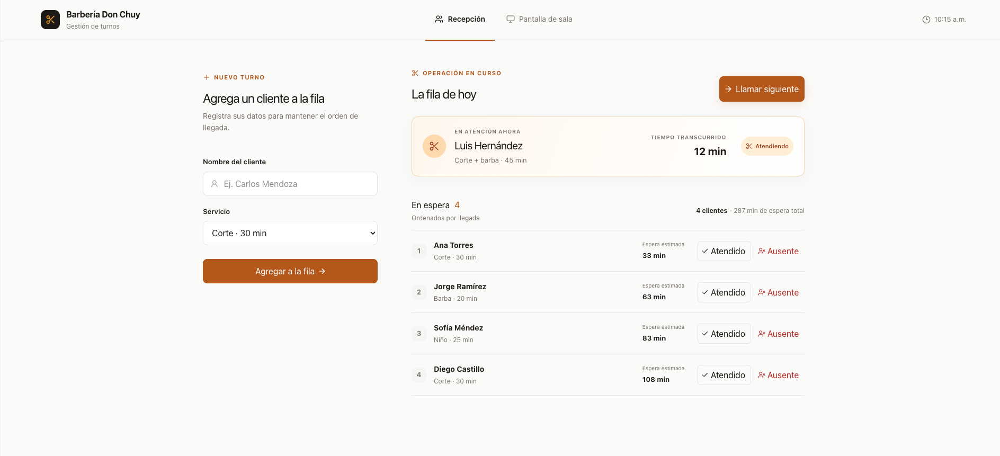

# Turnero App



## Problema

Aplicación para Barberías, consultorios y taquerías que llevan la fila de espera de memoria o en papel, los clientes no saben cuánto esperarán. 
La app permite a recepción registrar clientes, llamar al siguiente y mostrar la espera estimada.

## Funcionalidades

1. Agregar cliente con nombre y servicio (cada servicio tiene duración).
1. Llamar al siguiente; solo un cliente "atendiendo" a la vez.
1. Marcar atendido o ausente (con confirmación).
1. Ver la espera estimada por persona y total.

## Stack

- React
- TypeScript
- Headless UI
- Lucide Icons
- Vite
- TailwindCSS
- pnpm

## Para correr el proyecto en local hay que seguir los siguientes pasos

```bash
git clone git@github.com:franciscorochamont/turnero.git
cd turnero
pnpm install
```
**Levantar el servidor**
```bash
pnpm dev
```

**Comandos de verificación**
```bash 
pnpm tsc -b
pnpm lint
```
## Que aprendí?

Pendiente de escribir
