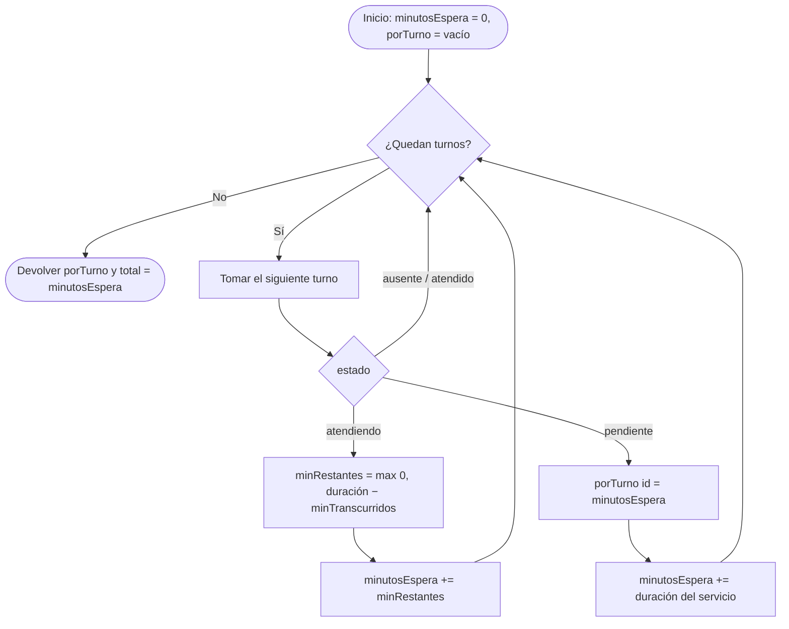

# Algoritmo de `calcularEspera`

Explicación visual de [`fila.ts`](./fila.ts): cómo `calcularEspera` convierte la fila en minutos de espera.

---

## 1. La idea en una frase

> Recorremos la fila **del primero al último** con un **acumulador** de minutos.
> Cada pendiente espera lo que se acumuló antes de él y, después, suma la duración
> de su servicio para los que vienen detrás.

Es como una fila en la barbería: tú no esperas por *tu* corte, esperas por **todos los cortes que van antes que tú**.

---

## 2. Entradas y salida

```
            ┌─────────────────────────┐
 fila ────► │                         │
 (Turno[])  │     calcularEspera      │ ────►  EsperaFila
            │     (función pura)      │        {
 horaActual │                         │          porTurno: { [id]: minutos },
 (ms) ────► │                         │          total: minutos
            └─────────────────────────┘        }
```

| Dato | Tipo | De dónde viene |
|---|---|---|
| `fila` | `Turno[]` | El estado de `App` (en orden de llegada) |
| `horaActual` | `number` (ms) | `Date.now()` — se pasa como parámetro para que la función sea **pura** y se pueda probar con cualquier hora |
| `porTurno` | `Record<string, number>` | Minutos de espera de **cada pendiente**, usando su `id` como clave |
| `total` | `number` | Minutos hasta terminar **toda** la fila |

**¿Por qué pura?** Mismas entradas → misma salida, sin tocar nada de afuera. Si dentro llamáramos a `Date.now()`, el resultado cambiaría cada milisegundo y no podríamos probarla.

**¿Por qué no se guarda en el estado?** Porque se puede **calcular** a partir de la fila. Es un valor *derivado*: si lo guardaras, tendrías dos fuentes de verdad que se pueden desincronizar.

---

## 3. Diagrama de flujo



Versión en texto (por si tu vista previa no muestra Mermaid):

```
para cada turno en la fila:
 │
 ├─ ¿ausente o atendido? ──► se ignora (continue)       ┐
 │                                                      │  no hacen esperar
 │                                                      ┘  a nadie
 ├─ ¿atendiendo?  ──► suma SOLO lo que le falta
 │                     restante = max(0, duración − transcurrido)
 │
 └─ ¿pendiente?   ──► 1) anota su espera  = acumulado actual
                       2) acumulado      += su duración
```

> ⚠️ El orden de los pasos 1 y 2 en el pendiente es **la clave del algoritmo**.
> Si los inviertes, cada cliente esperaría también su propio servicio.

---

## 4. Ejemplo paso a paso

Son las **10:10**. La fila es:

| # | Cliente | Servicio | Duración | Estado | Inicio |
|---|---|---|---|---|---|
| 1 | Pedro | Corte | 30 min | `atendido` | — |
| 2 | Luis | Corte + barba | 40 min | `atendiendo` | 10:00 |
| 3 | Ana | Corte | 30 min | `pendiente` | — |
| 4 | Sofía | Cejas | 15 min | `ausente` | — |
| 5 | Eva | Barba | 20 min | `pendiente` | — |

### Traza del acumulador

```
turno     estado       acción                               minutosEspera   porTurno
───────── ──────────── ──────────────────────────────────── ─────────────── ─────────────────────
(inicio)                                                     0               {}
Pedro     atendido     continue                              0               {}
Luis      atendiendo   lleva 10 → faltan 40 − 10 = 30        0 + 30 = 30     {}
Ana       pendiente    anota 30, luego suma 30               30 + 30 = 60    { ana: 30 }
Sofía     ausente      continue                              60              { ana: 30 }
Eva       pendiente    anota 60, luego suma 20               60 + 20 = 80    { ana: 30, eva: 60 }
───────── ──────────── ──────────────────────────────────── ─────────────── ─────────────────────
resultado → { porTurno: { ana: 30, eva: 60 }, total: 80 }
```

### En una línea de tiempo

```
ahora (10:10)
  │
  ▼
  ├──── Luis (faltan 30) ────┼──────── Ana (30) ─────────┼──── Eva (20) ────┤
  0                          30                          60                 80 min
                             ▲                           ▲                  ▲
                    Ana empieza aquí            Eva empieza aquí        total
                    porTurno[ana] = 30          porTurno[eva] = 60
```

Pedro y Sofía no aparecen en la línea: Pedro ya fue atendido y Sofía se marcó como ausente, así que ninguno hace esperar a nadie.

---

## 5. El cálculo del "atendiendo"

```
inicioAtencion            horaActual
     10:00                  10:10
       │◄── transcurrido ──►│◄──────── restante ────────►│
       ├────────────────────┼────────────────────────────┤
       0                    10                           40 min (duración)

msTranscurridos  = horaActual − inicioAtencion     →  600 000 ms
minTranscurridos = msTranscurridos / MS_POR_MINUTO →  10 min
minRestantes     = max(0, 40 − 10)                 →  30 min
```

**¿Por qué `MS_POR_MINUTO`?** `Date.now()` está en **milisegundos**, pero `duracionMin` está en **minutos**. Restar unidades distintas sería como restarle metros a kilómetros sin convertir antes.

**¿Por qué `Math.max(0, …)`?** Si Luis lleva 50 min en un servicio de 40, `40 − 50 = −10`. Un tiempo restante negativo le *restaría* minutos a la espera de los demás. `Math.max` lo deja en 0.

```
sin Math.max:  ├─ Luis (−10) ─┤  → Ana esperaría −10 min  ❌
con Math.max:  Luis aporta 0   → Ana esperaría 0 min      ✅
```

---

## 6. Supuestos y casos límite

| Caso | Qué pasa hoy | ¿Correcto? |
|---|---|---|
| Fila vacía | `{ porTurno: {}, total: 0 }` | ✅ |
| Solo atendidos/ausentes | `total: 0` | ✅ |
| Nadie atendiendo | El primer pendiente espera 0 | ✅ |
| Servicio excedido | El atendiendo aporta 0 (gracias a `Math.max`) | ✅ |
| `atendiendo` **sin** `inicioAtencion` | No entra en ningún `if` → aporta 0 en silencio | 🤔 |
| `atendiendo` **después** de pendientes en el array | La espera de los pendientes que están antes no incluye lo que le falta al atendiendo | 🤔 (por eso el supuesto en el JSDoc) |
| Minutos con decimales (19.5) | Se devuelven tal cual; se redondean al mostrar | ✅ (decisión explícita) |

Los dos 🤔 no son errores del algoritmo, sino **supuestos** sobre cómo `App` arma la fila. Conviene que el código que cambia los estados (por ejemplo, "llamar al siguiente") los garantice.

---

## 7. Conceptos que practica este archivo

- **Función pura**: la hora entra por parámetro, no se lee adentro.
- **Valor derivado**: la espera se calcula en el render, nunca se guarda con `useState`.
- **Acumulador en un bucle**: `minutosEspera` "recuerda" lo sumado hasta el punto actual.
- **Unión de tipos** (`EstadoTurno`): cada `if` corresponde a uno de los cuatro estados.
- **`Record<string, number>`**: diccionario por `id` para buscar la espera de un turno en O(1).

---

## 8. Pregunta para ti

Si en `App` haces:

```ts
const espera = calcularEspera(fila, Date.now());
```

…¿el número en pantalla se actualizará solo mientras Luis sigue en la silla, aunque nadie toque la fila? ¿Por qué sí o por qué no? (Pista: ¿qué hace que un componente vuelva a renderizar?)
